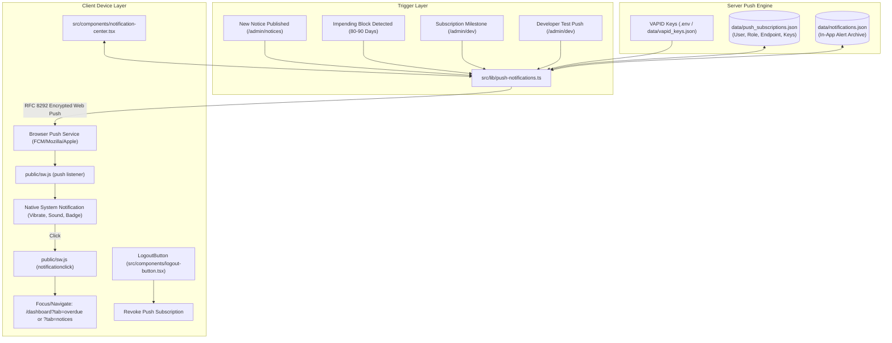

# Phase 25: Push Notifications & Instant Field Alerts Plan

## Objective
Equip Medical Representatives (MRs) and Administrators with real-time Web Push Notifications and an in-app Alert Center. Deliver proactive warnings for impending customer blocks (80–90 days overdue), instant broadcast alerts when new official circulars are published, subscription lifecycle reminders, and actionable field notifications directly to field mobile devices and desktop browsers—with strict per-MR privacy isolation and shared-device push unregistration.

---

## Architecture & Data Flow



---

## Detailed Implementation Waves

### Wave 1: Core Web Push & VAPID Key Infrastructure
- **Dependencies**: Add `web-push` and `@types/web-push` via `pnpm add web-push && pnpm add -D @types/web-push`.
- **Create**: `src/lib/push-notifications.ts`
  - **VAPID Key Pair Management**:
    - Auto-load from `NEXT_PUBLIC_VAPID_PUBLIC_KEY` and `VAPID_PRIVATE_KEY` in environment.
    - If absent, auto-generate on first launch via `webpush.generateVAPIDKeys()` and safely persist to `data/vapid_keys.json` (git-ignored).
    - RFC 8292 compliant contact subject: `mailto:support@devfinity.net`.
  - **Subscription Persistence (`data/push_subscriptions.json`)**:
    - Schema:
      ```typescript
      interface StoredPushSubscription {
        id: string;
        userId: string;
        role: "MR" | "ADMIN" | "DEVELOPER";
        endpoint: string;
        keys: {
          p256dh: string;
          auth: string;
        };
        userAgent?: string;
        createdAt: string;
        lastActiveAt: string;
      }
      ```
    - Methods:
      - `getVapidPublicKey()`: Returns public key for client registration.
      - `savePushSubscription(userId, role, sub, userAgent?)`: Atomically saves/updates subscription; prunes duplicates for same endpoint.
      - `removePushSubscription(endpoint)`: Prunes uninstalled or revoked endpoints.
      - `removeUserPushSubscriptions(userId)`: Prunes all endpoints for a user (called during shared device switch / logout).
      - `sendPushToUser(userId, payload)`: Sends encrypted notification to all active devices of a specific user.
      - `sendPushToRole(role, payload)`: Dispatches push notification to all users with a specific role (`MR` or `ADMIN`).
      - `sendBroadcastPush(payload)`: Broadcasts alert to all registered subscribers.
      - Auto-pruning: Automatically catches `410 Gone` and `404 Not Found` response codes from push gateways and cleans dead endpoints.
  - **In-App Notification Archive (`data/notifications.json`)**:
    - Stores recent notifications with schema:
      ```typescript
      interface InAppNotification {
        id: string;
        recipientUserId?: string; // Empty = broadcast
        recipientRole?: "MR" | "ADMIN" | "ALL";
        title: string;
        body: string;
        category: "OVERDUE" | "NOTICE" | "SUBSCRIPTION" | "SYSTEM";
        urgency: "HIGH" | "MEDIUM" | "LOW";
        url?: string;
        createdAt: string;
        readBy: string[]; // List of user IDs who marked as read
      }
      ```
    - Methods: `addNotification()`, `getNotificationsForUser(userId, role)`, `markNotificationAsRead(userId, notificationId)`, `markAllNotificationsAsRead(userId)`.
- **Create**: `src/server/actions/pushActions.ts`
  - Server actions providing authenticated client-to-server operations:
    - `getVapidPublicKeyAction()`
    - `savePushSubscriptionAction(sub: PushSubscriptionJSON, userAgent?: string)`
    - `removePushSubscriptionAction(endpoint: string)`
    - `getUserNotificationsAction()`
    - `markNotificationReadAction(notificationId: string)`
    - `markAllNotificationsReadAction()`
    - `sendTestPushAction(targetUserId?: string, customTitle?: string, customBody?: string)`

---

### Wave 2: Service Worker Push & Notification Click Handlers
- **Update**: `public/sw.js`
  - Add `push` event handler:
    - Safely parses Web Push JSON payload: `{ title, body, icon, badge, data: { url, alertType, id }, tag }`.
    - Fallback text handler for non-JSON payloads.
    - Calls `self.registration.showNotification(title, options)` with:
      - `icon: "/favicons/android-chrome-192x192.png"`
      - `badge: "/favicons/android-chrome-192x192.png"`
      - `vibrate: [200, 100, 200]`
      - `tag`: payload tag (groups similar notifications)
      - `renotify: true`
      - `data`: URL and notification ID for deep linking.
  - Add `notificationclick` event handler:
    - Closes notification immediately via `event.notification.close()`.
    - Deep-linking client resolution:
      - Reads `event.notification.data?.url || "/dashboard"`.
      - Scans `clients.matchAll({ type: "window", includeUncontrolled: true })`.
      - If an existing tab is open on the origin, focuses it and navigates to the target URL.
      - If no tab is open, opens a new window via `clients.openWindow(url)`.

---

### Wave 3: In-App Notification Center & Push Subscription Toggle
- **Create**: `src/components/notification-center.tsx`
  - Interactive top-bar bell button with unread count badge (animated bounce on new unread).
  - Popover Drawer / Dropdown:
    - **Header**: "Notifications & Alerts" with unread count and "Mark all as read" button.
    - **Push Permission Banner**:
      - If `Notification.permission === "default"`: Sleek banner *"Enable instant push alerts on this device"* with "Enable" button.
      - If `Notification.permission === "granted"`: Subtle green dot *"Push alerts active"*.
      - If `Notification.permission === "denied"`: Informative note *"Push notifications blocked in browser settings"*.
    - **Alert List**:
      - Categorized cards with distinctive icons:
        - `AlertTriangle` (Amber/Red) for Overdue & Impending Block alerts.
        - `Megaphone` / `Bell` (Cyan/Blue) for Circulars & Notices.
        - `ShieldAlert` (Purple) for Subscription & Maintenance reminders.
        - `Info` for General alerts.
      - Displays formatted relative timestamps ("5m ago", "2h ago", "Yesterday").
      - Unread indicator dot; click to mark as read and navigate to deep link (`/dashboard?tab=overdue`, etc.).
      - Empty state: *"No notifications right now. You're all caught up!"*.
- **Mount Component**:
  - Add `<NotificationCenter />` in `src/app/(mr)/layout.tsx` (MR top header next to offline pill).
  - Add `<NotificationCenter />` in `src/app/admin/layout.tsx` (Admin/Developer header).
- **Shared Device Security & Multi-MR Isolation**:
  - Update `src/components/logout-button.tsx`:
    - On logout, call `removePushSubscriptionAction(endpoint)` and unregister the service worker push manager subscription on the device.
    - This ensures that if MR "A" logs out and MR "B" logs into the same phone, MR "B" will never receive MR "A"'s customer block or overdue push notifications.

---

### Wave 4: Automated Field Alert Triggers
- **Trigger 1: Circular / Notice Announcements (`src/server/actions/notices.ts`)**:
  - When Admin calls `createNoticeAction`:
    - Persist notice to `data/notices.json`.
    - Dispatch push:
      ```typescript
      await sendPushToRole("MR", {
        title: `📢 New Circular: ${notice.title}`,
        body: notice.description || "An official announcement has been published. Tap to read.",
        url: "/dashboard?tab=notices",
        category: "NOTICE",
      });
      ```
    - Also archive in `data/notifications.json` for in-app viewing.
- **Trigger 2: Impending Block & Overdue Threshold Warnings (`src/server/actions/overdueReports.ts`)**:
  - When overdue reports are evaluated or when an MR loads their dashboard:
    - Check for customers with overdue age between 80–90 days (impending ERP block warning).
    - If found and not already alerted in last 24h:
      - Dispatch targeted push strictly to the assigned MR:
        ```typescript
        await sendPushToUser(assignedMrId, {
          title: `⚠️ Impending Block: ${customerName}`,
          body: `Invoice overdue by ${days} days (${formatCurrency(amount)}). Follow up to prevent order suspension.`,
          url: "/dashboard?tab=overdue",
          category: "OVERDUE",
        });
        ```
- **Trigger 3: Subscription Expiration Warnings (`src/lib/license.ts`)**:
  - When subscription expiration check runs:
    - If remaining days <= 14, send push alert to all Admins & Developers:
      ```typescript
      await sendPushToRole("ADMIN", {
        title: "⚠️ Subscription Renewal Alert",
        body: `PharmaQL license expires in ${daysRemaining} days. Contact support to renew.`,
        url: "/admin/dev",
        category: "SUBSCRIPTION",
      });
      ```

---

### Wave 5: Developer Diagnostics & Verification Suite
- **Developer Push Dispatcher (`src/components/dev-control-center.tsx`)**:
  - Add a dedicated **Push & Notification Dispatcher** section in Tab 1 (Overview) or Tab 7 (Diagnostics):
    - Subscribed devices count breakdown (`MR`, `ADMIN`, `DEVELOPER`).
    - One-click "Send Test Push Alert" targeting:
      - "Current Session" (self-test)
      - "All Active MRs"
      - "All Admins"
    - Displays last push dispatch status, delivery latency, and endpoint prune count.
- **Automated Verification Script (`scratch/test-phase25-notifications.ts`)**:
  1. Test VAPID key generation and consistency.
  2. Test `savePushSubscription`, retrieval, deduplication, and `removePushSubscription`.
  3. Test multi-MR isolation: Ensure `sendPushToUser` only targets the specified user's endpoints.
  4. Test in-app notification creation, role filtering, and mark-as-read mechanics.
  5. Test payload formatting, URL deep-linking, and JSON schema validation.
- **Compilation & Regression Gates**:
  - `pnpm exec tsc --noEmit` exits 0.
  - `scratch/test-phase24-pwa.ts` exits 0.
  - `pnpm run build` exits 0.
  - Confirm 0 writes to legacy MySQL ERP database (`pdyasvmaster`).
