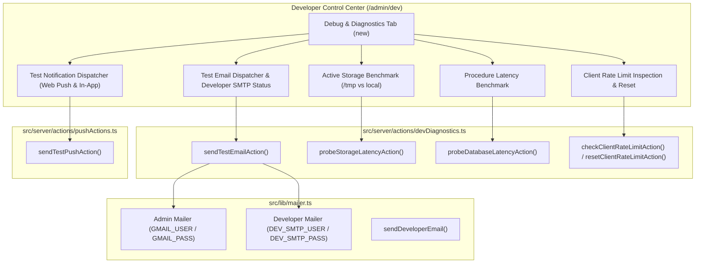

# Phase 26: Developer Debug Suite & Email Credentials Integration Plan

## Objective
Provide developers with a dedicated, high-visibility **Debug Console** tab within `/admin/dev`, equipping them with interactive test buttons for Web Push notifications, in-app alerts, SMTP email dispatch, storage latency, rate limit testing, and procedure diagnostics. Add full support for **Developer Email Credentials** (`DEV_SMTP_USER`, `DEV_SMTP_PASS`, `DEV_EMAIL`) so subscription reminders, renewal notices, and developer system alerts originate directly from the developer's email credentials to Admins and MRs.

---

## Architecture & Data Flow

---

## Detailed Implementation Waves

### Wave 1: Developer Mailer Transporter & Email Credentials Integration
- **Modify**: `src/lib/mailer.ts`
  - Implement `getDeveloperMailer()`:
    - Checks for `DEV_SMTP_USER` and `DEV_SMTP_PASS` in environment.
    - If present, creates/caches a dedicated nodemailer transporter configured with developer credentials (supports Gmail service or custom `DEV_SMTP_HOST` / `DEV_SMTP_PORT`).
    - If absent, gracefully falls back to primary `mailer` instance.
  - Implement `sendDeveloperEmail({ to, subject, html, text })`:
    - Sets `from` header to `"${organization || 'PharmaQL'} Developer" <${process.env.DEV_EMAIL || process.env.DEV_SMTP_USER || 'dev@asmeepharma.com'}>`.
    - Dispatches using the developer transporter.
  - Implement `verifyMailerConnection(type: "ADMIN" | "DEVELOPER")`:
    - Runs `transporter.verify()` and returns `{ success: boolean; latencyMs: number; error?: string }`.
- **Modify**: `src/lib/license.ts`
  - In `sendSubscriptionReminderEmails()`:
    - Route outgoing renewal reminder emails through `sendDeveloperEmail()` so emails sent from developer to Admins originate from developer credentials.
- **Modify**: `src/lib/runtime-config.ts`
  - In `getMaskedEnvInspection()`:
    - Add masked inspection fields for `devSmtpUserConfigured`, `devSmtpUserMasked`, `devSmtpPassConfigured`.
- **Modify**: `.env.example`
  - Add documented template variables for `DEV_SMTP_USER`, `DEV_SMTP_PASS`, `DEV_SMTP_HOST`, `DEV_SMTP_PORT`.

---

### Wave 2: Server Actions for Diagnostic Probes & One-Click Testing
- **Modify**: `src/server/actions/devDiagnostics.ts`
  - Implement `sendTestEmailAction({ recipient, template, useDeveloperCredentials })`:
    - Enforces `DEVELOPER` session assertion.
    - Sends a formatted test email (OTP test, Renewal reminder test, System alert test) using either Developer or Admin credentials.
    - Returns delivery status, messageId, and timestamp.
  - Implement `probeStorageLatencyAction()`:
    - Enforces `DEVELOPER` session assertion.
    - Performs an atomic write, read, and delete of a timestamped probe file in `getServerDataDir()`.
    - Returns `{ activeDir: string, isServerless: boolean, writeMs: number, readMs: number, totalMs: number, success: boolean }`.
  - Implement `probeDatabaseLatencyAction()`:
    - Enforces `DEVELOPER` session assertion.
    - Dispatches a lightweight query to the Express API (`/api/debug` or `rptCompanyCustomerItemwiseSales`) to record HTTP round-trip latency and DB responsiveness.
  - Implement `checkClientRateLimitAction()` & `resetClientRateLimitAction()`:
    - Resolves client IP using `getClientIp()`.
    - Checks current sliding window tokens and offers one-click IP rate-limit reset.

---

### Wave 3: Developer Debug Console UI Tab in `DevControlCenter`
- **Modify**: `src/components/dev-control-center.tsx`
  - Add `debug` tab option to navigation: `{ id: "debug", label: "Debug & Diagnostics", icon: Terminal }`.
  - Build comprehensive `DebugPanel` view containing:
    1. **Interactive Notification Dispatcher Card**:
       - Title, body, urgency, deep-link inputs.
       - Target selector: Current User, Specific MR (from searchable MR list), All MRs, All Admins, Broadcast.
       - Send button with loading spinner and rich result card (delivered count, in-app notification badge, latency).
    2. **Email Connectivity & Credentials Card**:
       - Status badge for Admin SMTP (`GMAIL_USER`) and Developer SMTP (`DEV_SMTP_USER`).
       - If developer SMTP is not set, display an informative banner:
         `"Developer email credentials (DEV_SMTP_USER / DEV_SMTP_PASS) are not configured. Emails will default to the standard admin mailer until set in environment variables."`
       - Test email form (recipient email, template selector, credential toggle, send test button).
    3. **Active Storage Engine Latency Card**:
       - Displays current active directory (`/tmp/pharmaql-data` vs `data/`).
       - One-click "Run Storage Benchmark" button showing write and read latency meters.
    4. **Rate Limiting & Security Card**:
       - Displays detected client IP.
       - "Check IP Limit" and "Reset My IP" buttons.
    5. **Database & API Health Probe Card**:
       - One-click "Ping API Server & MySQL" button showing live latency and connection status.

---

### Wave 4: Verification Suite & Quality Gates
- **Create**: `scratch/test-phase26-debug.ts`
  - Test developer mailer transporter resolution and fallback.
  - Test test email action structure.
  - Test active storage benchmark execution.
  - Test rate limit reset action.
- **Run Quality Gates**:
  - `pnpm run typecheck` (tsc --noEmit).
  - `pnpm run build` (Next.js production build verification).
