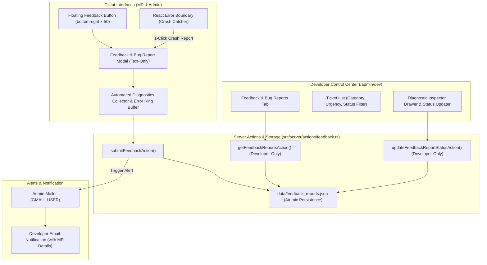

# Phase 27: In-App Feedback & Error Reporting System Plan

## Objective
Equip PharmaQL with a streamlined, reliable **In-App Feedback and Error Reporting System**. This empowers Medical Representatives (MRs) and Admins to report bugs, data discrepancies, UI glitches, or feature requests directly from the field or office. Submissions are strictly text-based and lightweight, augmented with automated client diagnostics (route, tab, division, browser, OS, viewport, user metadata, recent console errors). Submitted reports are **accessible exclusively to Developers** within `/admin/dev`, and trigger an automated email to the Developer via the Admin Mailer containing full user and MR attribution details. A global React Error Boundary prevents white-screen crashes and provides a 1-click crash reporting flow.

---

## Architecture & Data Flow

---

## Detailed Implementation Waves

### Wave 1: Storage Layer, Server Actions & Developer Email Dispatch
- **Create**: `src/lib/feedback.ts`
  - Define TypeScript types: `FeedbackReport`, `FeedbackCategory`, `FeedbackUrgency`, `FeedbackStatus`, `FeedbackDiagnostics`.
  - Implement `readFeedbackReports()` and `writeFeedbackReports()` with file locking / atomic persistence in `getServerDataDir()` (`data/feedback_reports.json`).
  - Implement `createFeedbackReport(data)`: Generates ID (`FB-YYYYMMDD-XXXX`), sets status `OPEN`, timestamps, and persists.
  - Implement `filterFeedbackReports(filters)`: Query by status, category, urgency, search query, role.
  - Implement `updateFeedbackStatus(id, status, developerNotes)`: Updates status and timestamps.
  - Implement `sendFeedbackDeveloperAlert(report)`:
    - Sends an email to the Developer address (`DEV_EMAIL` or fallback) using the Admin Mailer (`mailer` transporter from `src/lib/mailer.ts`).
    - Subject: `[PharmaQL ${report.urgency}] ${report.category}: ${report.title} (from ${report.submittedBy.userName})`
    - Formats HTML body with prominent MR/Admin attribution card (Name, MR ID, Email, Role, Rank, Division), report title/description, and diagnostic metadata table.
- **Create**: `src/server/actions/feedback.ts`
  - `submitFeedbackAction(payload)`:
    - Validates session (authenticated MR, Admin, or Developer).
    - Captures server headers (IP, user agent).
    - Saves ticket via `createFeedbackReport()`.
    - Dispatches email alert asynchronously via `sendFeedbackDeveloperAlert()`.
  - `getFeedbackReportsAction(filters)`:
    - Gated strictly to `DEVELOPER` role (returns 403 Forbidden for MRs/Admins).
    - Returns list of feedback reports matching filters.
  - `updateFeedbackReportStatusAction({ id, status, developerNotes })`:
    - Gated strictly to `DEVELOPER` role.
    - Updates ticket status and notes.

---

### Wave 2: Floating Trigger & In-App Submission Dialog
- **Create**: `src/lib/client-error-tracker.ts`
  - Client-side error ring buffer (maximum 5 items).
  - Listens to `window.addEventListener("error")` and `window.addEventListener("unhandledrejection")` to capture recent errors safely.
- **Create**: `src/components/feedback-modal.tsx`
  - Text-only feedback modal dialog.
  - Category selector:
    - 🐛 `Bug / Crash Report`
    - 📊 `Data Discrepancy`
    - 💡 `Feature Request`
    - 💬 `General Feedback`
  - Urgency selector: `LOW`, `NORMAL`, `HIGH`, `CRITICAL`.
  - Title input, multiline description textarea, optional contact note.
  - Automatically captures URL, active tab (`tab=...`), division, viewport dimensions, browser/OS, and error ring buffer.
  - Loading and success confirmation states.
- **Create**: `src/components/floating-feedback-button.tsx`
  - Positioned at `fixed bottom-5 right-5 z-50`.
  - Sleek, modern floating button with icon (message-square / bug), tooltip, and badge.
  - Mounted globally in authenticated layouts (`src/app/dashboard/layout.tsx`, `src/app/admin/layout.tsx`).

---

### Wave 3: Global React Error Boundary & Crash Reporting
- **Create**: `src/components/error-boundary.tsx`
  - React class component implementing `componentDidCatch(error, errorInfo)`.
  - Renders a polished, branded fallback card if a render exception occurs.
  - Features:
    - Friendly title: *"Something unexpected occurred"*
    - **"Report this Error to Developers"** button: Opens `FeedbackModal` pre-populated with category `BUG`, urgency `CRITICAL`, error name/message, component stack, and diagnostic logs for 1-click submission.
    - **"Reload Page"** and **"Back to Dashboard"** fallback actions.
- **Integrate**:
  - Wrap MR Dashboard and Admin Dashboard root views with `<ErrorBoundary>`.

---

### Wave 4: Developer Control Center Feedback Management Tab
- **Modify**: `src/components/dev-control-center.tsx`
  - Add `feedback` tab to navigation with icon (`LifeBuoy` / `MessageSquare`).
  - Build `FeedbackManagementPanel`:
    - Summary metrics bar: Total Tickets, Open, Under Review, Resolved, Critical.
    - Filter controls: Status (`All`, `Open`, `Under Review`, `Resolved`), Category, Urgency.
    - Search input (searches ticket ID, title, description, submitter name/email).
    - Ticket list cards with submitter badge (MR vs Admin, rank), timestamps, and status pills.
    - Slide-over inspection drawer showing complete diagnostic breakdown, error logs, submitter details, and quick status update controls with developer notes.

---

### Wave 5: Verification, Automated Testing & Quality Gates
- **Create**: `scratch/test-phase27-feedback.ts`
  - Test feedback report creation, ID formatting, and JSON storage persistence.
  - Test diagnostic payload serialization.
  - Test developer alert email generation and MR attribution formatting.
  - Test role security gates (verify non-developers cannot query feedback tickets).
  - Test status updates and developer notes.
- **Verification Gates**:
  - Run `scratch/test-phase27-feedback.ts` with passing assertions.
  - Run `pnpm exec tsc --noEmit` with zero type errors.
  - Run `pnpm run build` with clean build completion.
  - Commit, merge, and push to `localdb`, `dev`, and `prod`.
