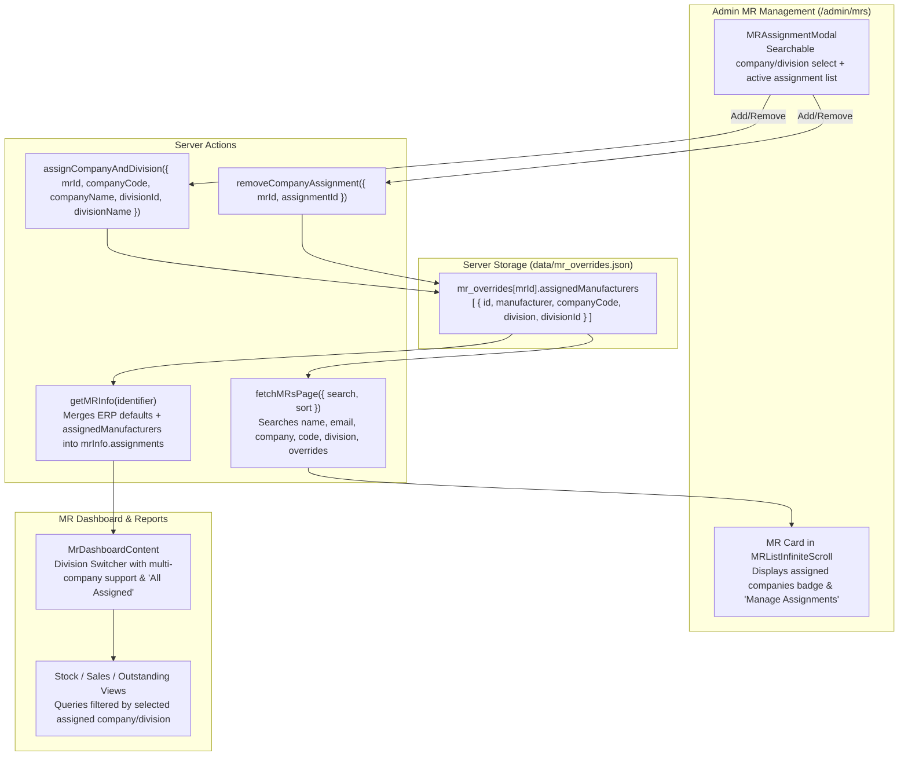

# Phase 28: Multi-Division & Multi-Company MR Assignment Management Plan

## Objective
Equip PharmaQL with end-to-end multi-division and multi-company assignment capabilities for Medical Representatives (MRs). Admins and Developers can assign multiple marketing companies (`m_mktcompany`) and divisions (`l_mktcompany`) to any MR from `/admin/mrs`. MRs can seamlessly view, switch between, or aggregate reports across their assigned companies/divisions, and MR lookups in Admin and Developer views are fully searchable by company name.

---

## Architecture & Data Flow



---

## Implementation Waves

### Wave 1: Data Model, Server Actions & MR Search Enhancement
- **File**: `src/lib/permissions.ts`
  - Update `MROverride` interface to type `assignedManufacturers`:
    ```ts
    assignedManufacturers?: Array<{
        id: string;
        manufacturer: string;
        companyCode?: string;
        division?: string | null;
        divisionId?: number | null;
        assignedAt?: string;
    }>;
    ```
- **File**: `src/server/actions/mrInfo.ts`
  - Update `LegacyMRUser` interface to add `assignments`:
    ```ts
    assignments?: Array<{
        id: string;
        manufacturer: string;
        companyCode?: string;
        division?: string | null;
        divisionId?: number | null;
    }>;
    ```
  - In `getMRInfo(identifier)`:
    - Build `assignments` list by merging the legacy primary assignment (`rawData.company` / `rawData.division`) with `override.assignedManufacturers`.
    - Return `assignments` on the resolved user profile.
  - In `fetchMRsPage`:
    - Enhance search filter logic so queries match `companyName`, `companyCode`, or any multi-assigned company names.
  - In `getAllMRsForDev`:
    - Ensure `companyCode` and `divisionId` are preserved in `assignments`.

- **File**: `src/server/actions/mrs.ts`
  - Implement `assignCompanyAndDivision({ mrId, companyCode, companyName, divisionId, divisionName })`.
  - Implement `removeCompanyAssignment({ mrId, assignmentId })`.
  - Add authorization check (must be `ADMIN` or `DEVELOPER`).
  - Revalidate paths `/admin/mrs` and `/admin/mrs/[id]`.

### Wave 2: Admin Assignment Modal & Manager UI
- **File**: `src/components/mr-assignment-modal.tsx`
  - Create interactive, accessible modal dialog:
    - Displays MR name, primary ERP division, and current custom assignments.
    - Searchable company select populated from `getAllMarketingCompaniesWithDivisions()`.
    - Division select (with "All Divisions in this Company" option).
    - "Add Assignment" button with instant optimistic UI update.
    - Badges for each assigned company/division with a delete (`✕`) button and confirmation.
- **File**: `src/app/admin/mrs/MRListInfiniteScroll.tsx`
  - Accept `allManufacturers` from props (already passed by `page.tsx`).
  - In MR Card info section, display:
    - Primary company & division.
    - Pill counter showing total assigned companies/divisions (e.g. `+2 additional companies`).
    - "Manage Assignments" button with icon (`Building2` or `Settings2`) to open `MRAssignmentModal`.

### Wave 3: MR Dashboard Division Selector & Report Query Alignment
- **File**: `src/components/mr-dashboard-content.tsx`
  - Replace hardcoded single `legacyDivision` fallback with full `mrInfo.assignments`.
  - Allow selecting individual assigned divisions or "All Assigned Companies".
  - Pass the active division/company selection down to report subcomponents.
- **File**: `src/server/actions/reports.ts` & download endpoints:
  - Verify that report data fetching respects the active company code/division.

### Wave 4: Verification, Quality Gates & Sync
- Run `pnpm exec tsc --noEmit` (ensure 0 errors).
- Run `pnpm run build` (ensure clean Next.js build).
- Test adding an assignment to an MR, verifying it shows in MR dashboard and reports.
- Test removing an assignment.
- Commit to `localdb` and push across `localdb`, `dev`, and `prod`.
