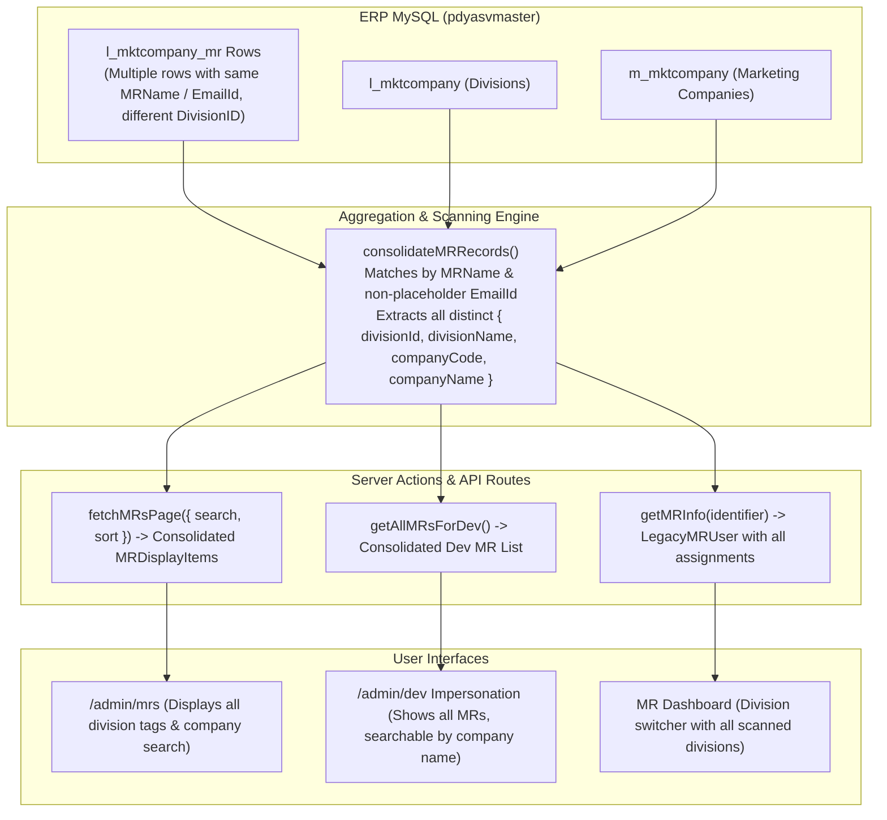

# Phase 28: Multi-Division MR Database Scanning & Aggregation Plan

## Objective
Automatically scan, aggregate, and display all division and company records for MRs in PharmaQL. The database (`pdyasvmaster.l_mktcompany_mr`) stores multiple entries for MRs with the same name and email across different `DivisionID`s. This plan consolidates those database records into unified MR profiles, enables company-name search in MR Impersonation and Admin lists, and provides a multi-division switcher on the MR dashboard.

---

## Architecture & Data Flow



---

## Implementation Waves

### Wave 1: Database Scanning & Profile Consolidation
- **File**: `src/server/actions/mrInfo.ts`
  - Update `LegacyMRUser` and `MRDisplayItem` to include `assignments`:
    ```ts
    assignments: Array<{
        id: string;
        divisionId?: number | null;
        division: string | null;
        companyId?: number | null;
        companyCode?: string;
        company?: string | null;
        manufacturer: string;
    }>;
    ```
  - Implement a centralized consolidation helper:
    `consolidateMRs(rawList: LegacyMRUser[]): MRDisplayItem[]`
    - Groups rows where `MRName` matches (case-insensitive) OR valid `EmailId` matches (excluding `@asmeepharma.com`).
    - Collects all unique divisions and companies into `assignments`.
    - Merges company names and company codes.
  - Update `getMRInfo(identifier)`:
    - Resolves the requested MR, scans all database rows for matching name/email, and returns the consolidated profile with all `assignments`.
  - Update `getAllMRsForDev()`:
    - Uses `consolidateMRs` so the developer impersonation list contains the deduplicated list of all 182 MRs with all their divisions and companies.
  - Update `fetchMRsPage`:
    - Uses `consolidateMRs` before pagination and searching.
    - Enables searching across `company`, `companyCode`, `division`, `assignments`, `name`, and `email`.

- **File**: `api-server/src/routes/auth.ts` & `api-server/src/routes/master.ts`
  - Update `/api/auth/mr-lookup` and `/api/master/mr-info/:id` to scan for all matching rows in `l_mktcompany_mr` by `MRName` or `EmailId` instead of limiting to a single division.

### Wave 2: MR Impersonation & Admin MR List UI Enhancements
- **File**: `src/components/dev-control-center.tsx`
  - In the "MR Simulation & View-As" tab:
    - Display all divisions assigned to each MR as badges (or "+N more divisions").
    - Ensure search (`filteredMRs`) matches against company name, company code, division name, MR name, and email.
- **File**: `src/app/admin/mrs/MRListInfiniteScroll.tsx`
  - Update MR Card to display all scanned divisions (e.g. `ALTRX`, `MEDIBRUCK`, `SHREEJI`) as badges.
  - If multiple companies are present, display each company badge.

### Wave 3: MR Dashboard Division Switcher Synchronization
- **File**: `src/components/mr-dashboard-content.tsx`
  - Populate `effectiveAssignments` directly from `mrInfo.assignments`.
  - The division switcher dropdown will show all scanned divisions (e.g. `ALTRX`, `MEDIBRUCK`, `SHREEJI`) plus "All Divisions".
  - Ensure selecting a division passes that division and its corresponding `companyCode` to report components (`StockReportView`, `SalesReportView`, etc.).

### Wave 4: Verification, Quality Gates & Sync
- Verify all 5 known multi-division reps:
  - Amit Bhagat (ID 47, 244, 245 -> `ALTRX`, `MEDIBRUCK`, `SHREEJI`)
  - Kalpesh Rajpurohit (ID 182, 185 -> `SUMMIT-1`, `SUMMIT`)
  - Manish Lonkar (ID 82, 198 -> `APICAL - INETA`, `APICAL - LEVANTA`)
  - Ravikumar (ID 181, 183 -> `SUMMIT-1`, `SUMMIT`)
  - Sachin (ID 26, 92 -> `COSMEDERMA`, `VALITE`)
- Verify company search in Developer Impersonation and Admin MR list.
- Run `pnpm exec tsc --noEmit` (0 errors).
- Run `pnpm run build` (clean build).
- Push across `localdb`, `dev`, and `prod`.
